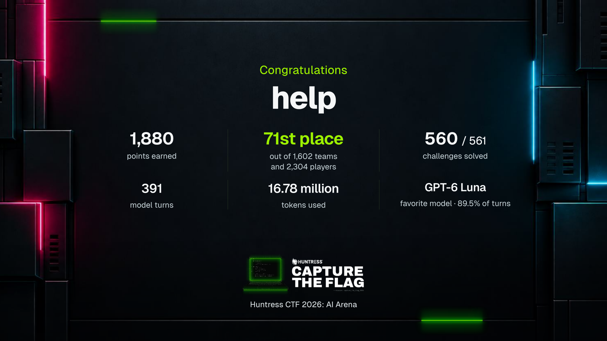
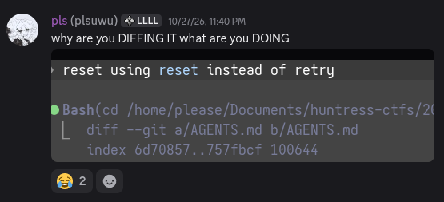

import Challenge from "./component/2/Challenge.svelte";

Back in 2023, the first Huntress CTF was more or less what introduced me to writing and analysing malware - I still have a [few](https://github.com/plsuwu/plsuwu/blob/c6b1248be42ae8a1626e576311acf52473fc7fce/src/docs/writeups/tragedy_redux.md) [old](https://github.com/plsuwu/plsuwu/blob/c6b1248be42ae8a1626e576311acf52473fc7fce/src/docs/writeups/speakfriend.md) [writeups](https://github.com/plsuwu/plsuwu/blob/c6b1248be42ae8a1626e576311acf52473fc7fce/src/docs/writeups/operation_eradication.md) from this time, though they're nothing I feel particularly proud of these days (read at your own peril). In any case, though, October of 2023 is a core memory: I thoroughly destroyed my Windows installation by detonating the challenge material (scripts and executables that were _just_ shy of actual malware) on my host machine, totally unisolated - and without being able to handle de-fanged malware like this (some [examples from 2025](https://github.com/plsuwu/huntress-ctfs/tree/master/2025)) I don't know that I would have ever discovered the same type of deep curiosity for a topic as complex as this. 

Four years out from the original 2023 competition, it isn't unreasonable to say that the current state of [agentic tools](https://en.wikipedia.org/wiki/AI_agent) (e.g. programs like Cursor, Codex, and so on) has thoroughly, uh, "altered" how the traditional CTF is played. For perspective: at the time (armed with no prior knowledge of OLE files, macro-based malware, or VBA scripting), [tragedy redux](https://github.com/plsuwu/plsuwu/blob/c6b1248be42ae8a1626e576311acf52473fc7fce/src/docs/writeups/tragedy_redux.md) probably took me somewhere in the realm of three-ish hours to solve. This was by no means a difficult challenge, however, and I'd say that I could realistically do the same challenge by hand today in like 10, maybe 15 minutes; Claude, alternatively, could tear through this in well under two (2!!).

Between these advancements and the monumental effort it takes to run something like this for a full month once a year, its totally understandable to fully lean into the slop of it all, but it's also just fundamentally not the same CTF that I fell in love with - and, tragically, I doubt I will ever see it again.

## Hello to all employers I am embracing AI please stop reading now thanks

> Look! 71st! Out of 1,602 teams!! Wow! [Thank](https://www.theguardian.com/technology/2026/jul/22/openai-says-its-models-went-rogue-and-hacked-startup-in-unprecedented-incident) [you](https://www.bbc.com/news/articles/cw24jm9rryy3o) [Sam](https://www.politico.com/news/2026/10/04/sam-altman-decoded-interview-ai-01106217) [Altman](https://www.androidheadlines.com/2026/10/sam-altman-pc-ram-comments-ai-data-centers.html)! 

The stats above describing model usage are mostly wrong - I primarily used local instances of OpenCode and Claude, but I occasionally found that running on the provided machine yielded better results (the box was running T3 code, so perhaps whatever system prompt it had was good for specific challenges, I don't know). You can view whatever garbage "my" agents set up in [this Github repository](https://github.com/plsuwu/huntress-2026). I have very little idea what any of this actually does, and it really is meant to serve as a bit of a "spectacle" or perhaps "oddity" - I wrote effectively none of the code in this repository, and I can't really comment on its usefulness (or whether it even runs). 

In whatever case, I don't want this to be straight-up hate mail - so I want to look at some of the things I enjoyed first. 

## The good parts

### Sha1-Hulud

[Nordgaren](https://x.com/NotNordgaren)'s `sha1-hulud` challenge was the only one of the challenges that I was unable to solve, and I thought this was genuinely a very cool little piece of software; I've uploaded my challenge binary [here](https://storage.googleapis.com/darkened-finance-sauna-siamese/public/sha1-hulud.zip) if you want to take a closer look at it. This guy was utterly loaded with anti-debug checks and language models were very quick to prematurely hyper-focus on junk - this challenge was in a totally different class compared to every other challenge this year.  

With this said, I feel like the only reason this went unsolved was due to the OpenAI and Anthropic-imposed cybersecurity safeguards; Claude and GPT kept hitting brick walls when they came within a millimeter of a direct syscall or a Unicorn script, and I don't think this wall would exist with Daybreak or CVP access (perhaps this was in part kind of intentional). This, alongside the fact that I didn't really want to dump 50+ AUD into OpenRouter (on account of some truly rancid exchange rates) just so that I could let Kimi run for a couple of hours meant that I was not so motivated to put in the effort to finish pulling it apart. Even still, this was still easily the best challenge this year. 

### Time trial/mastery

These were kind of fun in terms of satisfying some kind of primal competitive itch, though I didn't feel the same sense of achievement - they don't feel like my times because that's not really my program, if this makes sense. 

I last checked on the 29th, but [the Rust binary my robot built](https://github.com/plsuwu/huntress-2026/tree/main/main/ctf-run) had ~100 first place hall of fame solution times, out of the ~300 available timed challenges (I dedicated the last two days to `sha1-hulud`, so it was likely a bit lower than this by the end). I still had to fight Claude a bit to get it to do some things, including:

- Compiling locally using `musl` with [`mimalloc`](https://nickb.dev/blog/default-musl-allocator-considered-harmful-to-performance/), rather than compiling on the AWS VM itself (an optimisation that targets [AWS burstable performance](https://docs.aws.amazon.com/AWSEC2/latest/UserGuide/burstable-credits-baseline-concepts.html)).
- Use `zstd` for big POST request compression (Claude gave up immediately when the server didn't accept `gzip`).
- Use faster implementations built by smart people over the course of several years instead of hand-rolling garbage (like `SHA256`, cryptographic functions, compression).

Even then, it left a lot of hand-rolled junk in place for the sake of "portability" or "reference". 

### The robots were sometimes kind of funny

Stunning, another trillion to Anthropic.

## Hello to all Huntress staff I am so appreciative of your hard work please stop reading now thanks

While I tend not to do write-ups for CTF challenges these days, I think I would struggle to do so for effectively anything this year even I wanted to - I don't really think the challenges had a clear, human-oriented through-line. This is easily my biggest criticism - I don't actually know what a single challenge was about beyond its general category (with the exception of `sha1-hulud`, ironically), and the "prompt" was incomprehensible LLM prose. 

For example, the metadata/forensics challenge from day 14 looked something like the following (this is interactive by the way! It's my shitty from-memory partial recreation of the CourseStack UI if you want to try solving):

<Challenge client:load />

"A shortcut collection is a map of intent..."? What? What does that mean? "Identify the impossible dest-..." Am... Am I having some kind of medical emergency? 

Funny business aside - any kind of descriptive text felt like AI-generated noise. You know what I mean, I'm sure - its that type of writing that seems overly wordy and full of adjectives and jargon, but it somehow manages to remain impossibly vague and feels difficult to parse when you read through it. Maybe this was intentional, though, because spending time reading and comprehending anything means you were engaging with the CTF, which probably means you didn't have a `systemd` timer set up to tell your agent to solve the challenge the microsecond it releases, which means you were really were just setting yourself up to fail.

### Compare this to challenges from previous years

I want to use 2025's challenge [<i>Angler</i>](https://github.com/jasonrush/Huntress-CTF-2025-write-ups/tree/main/Angler) to elaborate on my frustrations here. <i>Angler</i> is *easily* one of my favorite CTF challenges ever, and we were basically just set loose on an [Entra](https://learn.microsoft.com/en-us/entra/fundamentals/what-is-entra) instance with a bunch of flags sequestered away in some truly absurd places (not mine, but read the linked writeup!!). 

Even the story - despite the absurd-sounding notion that a CTF challenge is story-driven - was genuinely creative and engaging. You could draw parallels here to a videogame, perhaps (it was vaguely World of Warcraft-themed but I never really got into WoW, sorry); a series of basic decoding exercises serves as a funnel to introduce you to the story and premise, before letting you out to explore the "open world" (so to speak) of Microsoft Entra. The intent was probably more along the lines of a bit of a silly joke, so it all reads a bit more facetiously than I've made out here, but that doesn't necessarily make my point less valid.

#### In the interest of remaining fair and balanced:

<i>Angler</i> absolutely took a lot of time and effort to set up and run, and it wasn't smooth the whole way through (meaning a non-trivial amount of effort went into upkeep as well); the effort differential isn't lost on me, but I found very little satisfaction in making a robot slop out its 20th identical slop solution to some other robot's slop challenge. You can actually more or less replace every "main" lane challenge (i.e. binary reverse engineering, metadata, warmups, mobile, and script deobfuscation) with "find `[arbitrary_string]` inside of `[file]` :)" and you effectively have the same competition. Web was slightly different, but it also quickly devolved into "have your robot try 123,794 slight variations of `[arbitrary_string]` against this website and see what sticks :)". 

Further to the contrary as well - the last couple of years have seen issues around flag sharing and inter-team collusion, and the way the challenges were implemented this year meant that it was much easier to have per-team flags to avoid this. I can see that it would have been incredibly tricky (probably closer to impossible) to do this for an <i>Angler</i>-style challenge - `sha1-hulud` implemented some kind of per-team flag thing at build time (I assume it was built on the server when you requested the link), but this probably wouldn't be feasible on every challenge, I imagine.    

Hopefully this reads closer to constructive criticism rather than, like, "that was utter garbage thanks for nothing and also i HATE you" - I think this style of competition is probably just not for me.

## In summary

I genuinely wanted to go into this with an open (if perhaps somewhat unavoidably tentative) mind - I'd never used this kind of tooling before, but maybe there *was* actually something to learn. With some very minor exceptions, I don't really think I learned anything from this experience. 

My comparison is that learning how to use agentic tools is like learning how to use Microsoft Word or something - but I feel like this kind of falls short, because  the laborious alternative to Microsoft Word doesn't necessarily yield a better and more human-centric result. I think the example challenge I gave speaks for itself in this regard, but I also felt like the code it would write was more than a little unmanageable. Like, yeah, of course, AI works significantly faster than I ever could, but doing this for any kind of long-term project would make me feel very uneasy; I think the code it wrote was worse than what a human would write, and I feel like I'm wading through mud trying to actually internalise the vague, jargon-filled documentation it generates. None of this really considers the societal or environmental effects of it all, or whether the "frontier" models are even economically viable post-hype; I don't think I have the capacity to explore any of this, but they aren't really notable factors for my desire to avoid these kinds of tools in my personal projects anyway. 

These feelings are moreso my thoughts on "doing it for the love of the game" - if an employer wants to pay me to babysit Claude or whatever then I'm going to have very few reservations about it, to be completely honest; it isn't the worst thing ever. It's definitely more interesting work than minimum wage at [Coles](https://www.accc.gov.au/system/files/accc-v-coles-concise-statement-stamped.pdf).
